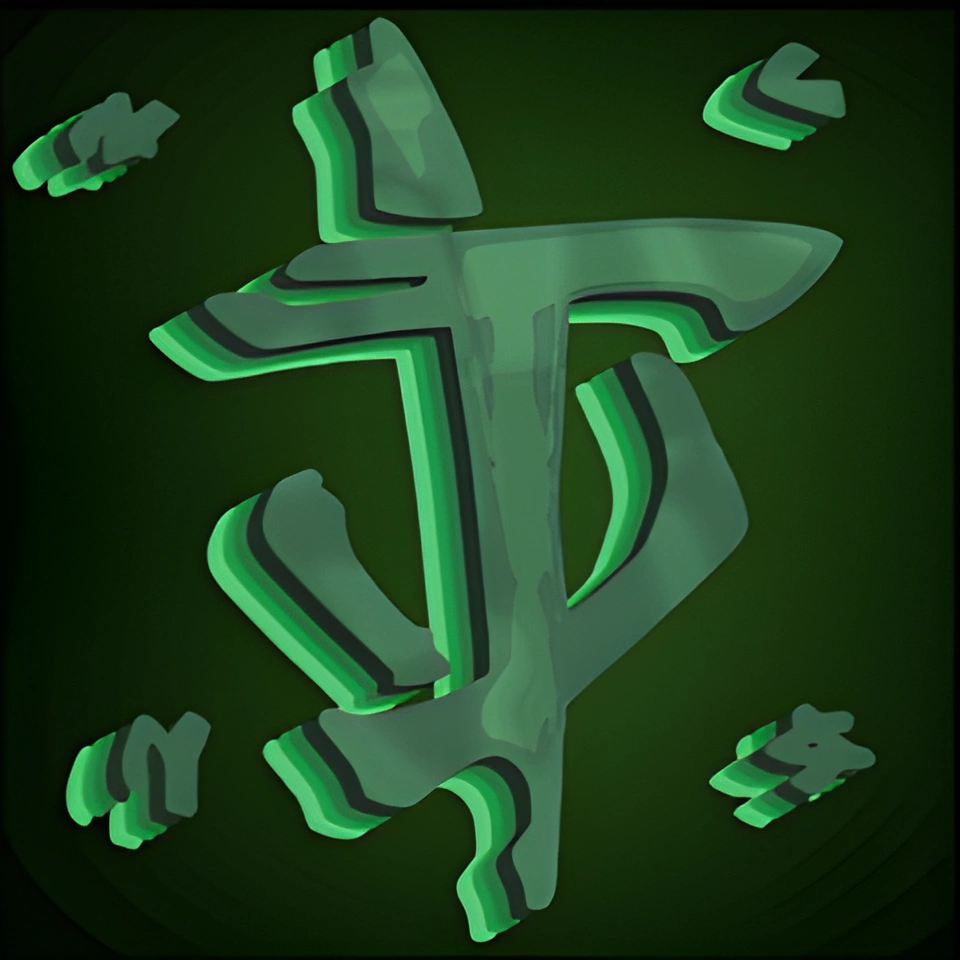

<p align="center">
  
</p>

<h1 align="center">LanSlayer</h1>

<p align="center">
A fan project bringing LAN multiplayer to DOOM (2016)
</p>

<p align="center">
  <a href="https://discord.gg/PvYPamMVes">
    
  </a>
  <a href="https://fluxer.gg/zzT8x6jO">
    
  </a>
</p>

> **Warning**
> DOOM (2016) LAN is a fan project. It is not affiliated with or endorsed by id Software or Bethesda Softworks.
> This was tested and made for a Steam copy.

A project to get DOOM (2016) Multiplayer and SnapMap working offline and over LAN with [GBE Fork](https://github.com/Detanup01/gbe_fork/releases). By default, the game gets stuck in loops or throws errors when launched without connection to Bethesda/Hydra online services.

---

## Getting Started
1. Download the release files from [here](https://github.com/birdenly/LanSlayer/releases).
2. Place the files next to your game executables to a folder named `LanSlayer`
3. Run `LanSlayer_Launcher.exe`. This patches both the OpenGL (`DOOMx64.exe`) and Vulkan (`DOOMx64vk.exe`) executables to work offline/locally and creates `.bak` backups of your original clean files. (Nearly ALL test were done on OpenGL, use it if Vulkan is giving problems)
4. Launch the game with the launcher.
---

## Playing Downloaded Maps in LAN Co-op
Maps in the Featured menu work without the setup below, simply start the lobby and invite other and they will work.

0. Download SnapMap maps from the main game (without the LAN patch), they will be placed in your savegame folder.

1. **Place the map files on each player's save folder:**
Each player places their downloaded map folder (e.g. `SNAPMAPS...`) inside their own save directory:
```
%USERPROFILE%\Saved Games\id Software\DOOM\base\savegame.user\<SteamID>\
```

2. **Launch the game:**
Launch the launcher and toggle the `SnapMap` option & press launch game.

3. **Pre-load the map in memory:**
All players enter SnapMap, go to **PLAY** -> **Featured Maps** -> Select ANY map -> **CHANGE MAP** -> **DOWNLOADED MAPS**, and select the same map so the engine loads the map assets into RAM in each session. Sadly, this will need to be done for every map change, this pre-load into memory was done by the main server.

4. After that, simply invite other players into the lobby and play. When the match ends do step 3 again.

---

### What's not done (TODO):
* Dedicated server support with RCON
* Coop for the story mode (Like synergy for half life 2)
* GOG support? (need to figure out a way to get the game with mp files there, also not sure if the current xdeltas are compatible)

## Credits
- birden
- twig
- blueballoon

### Third-Party
Following open-source projects were used:
- [ImGui](https://github.com/ocornut/imgui)
- [Radare2](https://github.com/radareorg/radare2)
- [XDelta](https://en.wikipedia.org/wiki/Xdelta)
- [Json](https://www.json.org/json-en.html)
- [GBE Fork](https://github.com/Detanup01/gbe_fork)
- [MinGW](https://www.mingw-w64.org)
